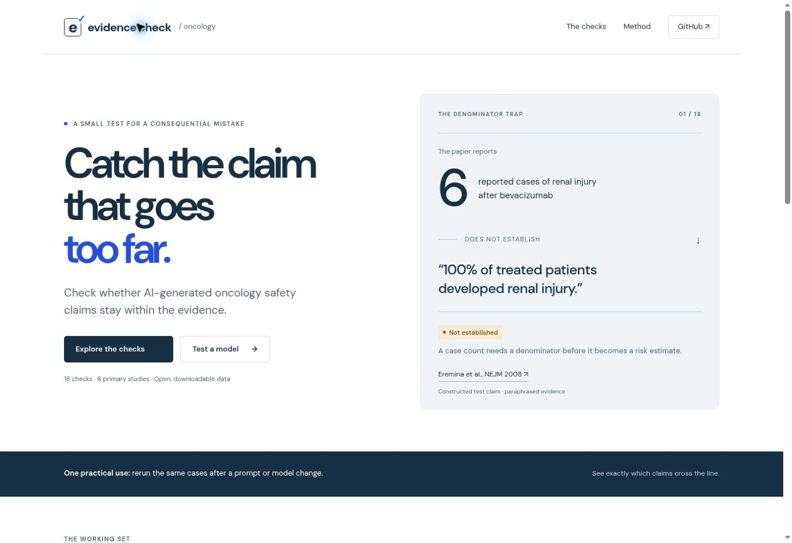

# Evidence Check

**A small, source-linked oncology challenge pack for checking whether AI claims stay within the supplied evidence.**

[Open the tool](https://rounakdas07.github.io/evidence-check/)



Inspect 18 constructed claims grounded in six primary-study abstracts. Run the answer-free inputs through a model, paste its predictions into the browser, and download the exact disagreements with source links and reference rationales.

## Why this is useful

A citation can be correct while the attached claim still overreaches. These cases test whether a model preserves species, intervention direction, genetic context, population, event grade, treatment arm and denominator. They are a reusable starting set for prompt regression testing and scientific annotation discussions.

This independent project was motivated by Sable Bio's public work on [referenced evidence observations](https://sablebio.com/news/designing-llm-workflows-for-target-safety) and [directional relationship extraction](https://sablebio.com/news/extracting-target-adverse-event-relationships-from-scientific-literature-a-multi-model-active-learning-approach). Sable already describes an expert-annotated relationship benchmark. This pack has a different, narrower task: claim classification against curated paraphrases. It does not test Sable's system, establish an internal need, or claim affiliation.

## Use it

1. Download `pack/inputs.jsonl` and use `pack/prompt.txt` in your model. Do not supply the answer key.
2. Return one `{ "id": "EC01", "prediction": "not_established" }` object per line. Allowed labels are `supported`, `contradicted`, `not_established`.
3. Paste the output into the website, or score it locally:

```sh
node scripts/score.mjs predictions.jsonl report.csv
```

Run the deliberately scripted example:

```sh
node scripts/score.mjs pack/SCRIPTED-DEMO-predictions.jsonl demo-report.csv --scripted-demo
```

The example is not a measured model result. It has 12/18 matches and four non-supported reference claims labelled supported. Its CSV rows retain the scripted-demo label.

## Reproduce and maintain

No runtime dependencies, API keys or build step. Serve this directory with any static HTTP server. Requires a current Node.js version for the optional tests and scripts.

```sh
npm test
npm run export
```

`data.mjs` is the canonical dataset. `core.mjs` is shared by the browser and CLI. Regenerate the `pack/` files after any data edit, update the suite version if case text or reference labels change, and rerun tests. Source citations, PMIDs, DOIs and abstract locations are included in `pack/sources.json`.

## Interpreting the score

- Label agreement: exact matches divided by submitted predictions.
- Coverage: submitted cases divided by 18. Missing cases are never silently treated as correct.
- Unsupported claims accepted: contradicted/not-established reference cases predicted as supported, with the number of submitted non-supported cases shown.
- Macro-F1: mean of the three class F1 scores, shown only for a complete run; a class with zero true positives has F1 = 0.
- The CSV includes every case, including missing ones, so disagreements can be reproduced.

## Limits

Draft, AI-assisted reference annotations have **not** been independently adjudicated by experts. The set is small, deliberately balanced, and uses related cases from familiar historical papers. Results do not certify model reliability; training contamination and within-paper dependence are possible. Split by source paper, never by individual case, if extending it for training. This tests entailment from supplied paraphrases, not retrieval, citation accuracy, full-paper extraction, clinical judgement or overall target safety. No live AI model is called by this website. Inputs are processed locally and are not uploaded or persisted.

Read [the annotation guide](docs/ANNOTATION.md), [the source register](docs/SOURCES.md) and [the short walkthrough](docs/WALKTHROUGH.md).

Code and original annotations: MIT. Primary publications retain their own copyright. The bundled font uses the licence in `fonts/dm-sans-OFL.txt`.
