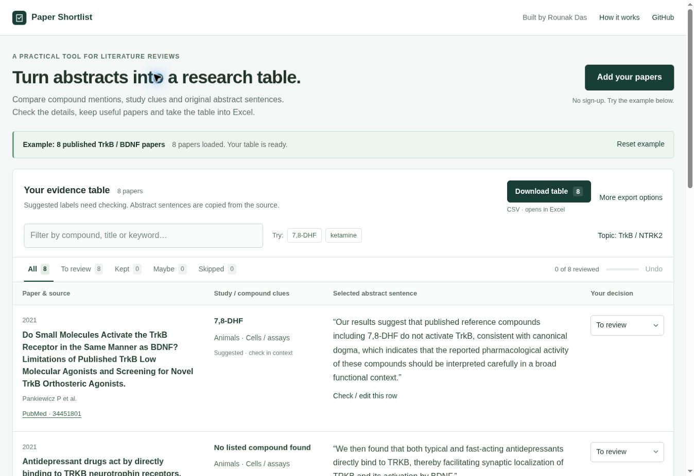

# Paper Shortlist

**Turn research abstracts into a comparison table you can check and use in Excel.**

The result is visible immediately: paper titles and source links, suggested compound and study clues, and an original sentence from each abstract where one is identified. Filter the table, correct a row, and download it without first reviewing every paper.

Built by [Rounak Das](https://github.com/rounakdas07). Independent project, not affiliated with Pangea Bio.

[Open Paper Shortlist](https://rounakdas07.github.io/evidence-check/paper-shortlist/)



## Try it

Eight published TrkB / BDNF papers are preloaded. No account or key is needed.

1. Compare the eight example papers directly in the table. Try **ketamine** to narrow the list to two papers.
2. Open **Check / edit this row** to read the abstract, correct a label, choose another sentence or add a note. Keep / Maybe / Skip decisions are optional.
3. **Download table** exports exactly the rows currently shown, with authors, original source links, selected sentences, suggested labels and your corrections in separate columns. CSV opens in Excel and Google Sheets.

Use **Add your papers** to search live PubMed records through Europe PMC, enter PubMed IDs, paste abstracts, or upload a PubMed `.nbib`, `.csv` or `.txt` file. Pasted abstracts become a table as soon as you select **Build my table**. Up to 50 records per API request and 250 per working list. The interface states how many search results were loaded.

On phones, the same rows become readable cards. **More export options** provides different inclusion scopes, a Markdown reading brief and a reusable JSON session backup.

## What is actually computed

- Literal topic matches, with matching papers placed first.
- Keyword clues for human tissue, human terms, animal work and cells/assays. Each clue can be checked against the sentence that triggered it.
- Mentions from a small neuroscience compound dictionary, including 7,8-DHF, LM22A-4, ketamine and psilocin.
- A result-like sentence copied **verbatim** from the supplied abstract, chosen using transparent phrases such as “we found”. Users can select another sentence.
- Review-paper flags and missing-abstract / mixed-human-animal warnings.

These are screening aids, not a validated study-design classifier or scientific-quality assessment. A mention does not establish that a compound was tested. Keywords can occur in background text. The tool does not read PDFs, decide efficacy, evaluate bias, or conduct a complete systematic review. Every inclusion decision is made by the user. There is no LLM, hidden model, invented efficacy score or claimed time-saving benchmark.

## Data, privacy and persistence

Live search uses the [Europe PMC REST API](https://europepmc.org/RestfulWebService), restricted to PubMed (`SRC:MED`) records. Search terms are matched within titles or abstracts, not full text. The newest batch is loaded and topic matches are then placed first. Search queries and IDs go directly to that service. Pasted text, uploaded files, decisions and notes are processed in the browser. There is no application backend, analytics or external AI service.

Work is saved to local storage on this browser. Use **Save session** for a portable JSON backup. Restoring a backup includes the original abstracts, decisions and edits. CSV is a review output; use JSON for full session restoration.

The bundled example was retrieved on 19 November 2026. All eight records were marked **CC BY** by Europe PMC. Their authors, DOI, PMID and PMC identifiers are preserved in [data/example.json](data/example.json). Abstracts are third-party scientific content under the original article's licence, not the software licence. Follow the original article for its exact licence version and attribution. No scientific wording has been generated for these records; display normalises HTML and whitespace.

| PMID | First author | Year | Source |
| --- | --- | --- | --- |
| 34451801 | Pankiewicz | 2021 | [PubMed](https://pubmed.ncbi.nlm.nih.gov/34451801/) |
| 33606976 | Casarotto | 2021 | [PubMed](https://pubmed.ncbi.nlm.nih.gov/33606976/) |
| 24802307 | Ray | 2014 | [PubMed](https://pubmed.ncbi.nlm.nih.gov/24802307/) |
| 33096634 | Colucci-D’Amato | 2020 | [PubMed](https://pubmed.ncbi.nlm.nih.gov/33096634/) |
| 27253067 | Sleiman | 2016 | [PubMed](https://pubmed.ncbi.nlm.nih.gov/27253067/) |
| 26327690 | Yang | 2015 | [PubMed](https://pubmed.ncbi.nlm.nih.gov/26327690/) |
| 37280397 | Moliner | 2023 | [PubMed](https://pubmed.ncbi.nlm.nih.gov/37280397/) |
| 40362507 | Toader | 2025 | [PubMed](https://pubmed.ncbi.nlm.nih.gov/40362507/) |

## Run locally

No build or install step. Serve this directory with any static web server; opening the HTML as `file://` will block the example fetch and ES modules in many browsers.

```sh
python3 -m http.server 8080
```

Node.js is needed only for the dependency-free checks:

```sh
npm test
npm run check
```

The deterministic logic and parsers are in `core.mjs`; interface and API integration are in `app.mjs`. The app uses relative asset paths and works under a GitHub Pages subdirectory.

## Licence

MIT for the software. Original scientific content retains its own licence and attribution as described above.
